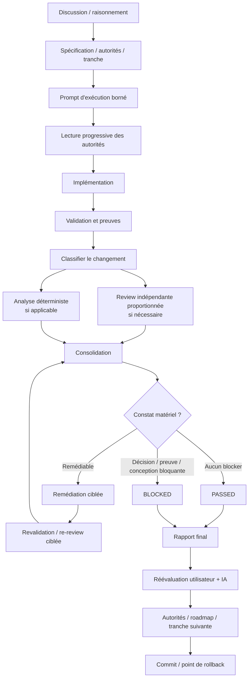

# Workflow d’ingénierie logicielle assistée par IA

Ce dépôt contient un workflow évolutif pour structurer le développement logiciel réalisé avec des assistants et agents IA.

Il s’est construit progressivement au fil de plusieurs projets et de l’évolution des capacités des modèles : d’une utilisation initialement centrée sur l’analyse, la compréhension et l’assistance ponctuelle au développement vers des tâches d’ingénierie de plus en plus autonomes, nécessitant davantage de cadrage, de contexte, de validation et de review.

L’objectif n’est pas de multiplier les documents, les agents ou les étapes de processus. Il est de fournir **juste assez de structure pour déléguer davantage sans perdre la maîtrise du périmètre, de l’architecture, des décisions et des preuves de validation**.

Ce dépôt représente l’état actuel de cette pratique. Il est amené à évoluer continuellement.

## Positionnement : Spec-Driven Development

Le workflow s’inscrit dans une logique de **Spec-Driven Development (SDD)** au sens large : expliciter le **quoi**, les contraintes et les critères d’acceptation avant de déléguer le **comment** de l’implémentation.

Il ne repose pas nécessairement sur un unique fichier de spécification. Sur un projet existant, la spécification utile peut être répartie entre plusieurs autorités : roadmap, architecture, ADR, contrats, plans de phase et tranche courante.

Le workflow va au-delà d’une simple séquence spécification → implémentation en ajoutant notamment :

- des autorités vivantes et séparées par responsabilité ;
- un chargement progressif du contexte ;
- des contrats et invariants explicites ;
- une validation proportionnée au risque ;
- une review indépendante proportionnée au changement ;
- une boucle de remédiation ;
- une qualification à échelle représentative lorsque nécessaire ;
- un statut `BLOCKED` pour éviter d’inventer silencieusement une décision manquante ;
- un checkpoint anti-dérive lorsque les corrections locales commencent à remettre en cause la conception.

Il ne s’agit pas d’une implémentation de GitHub Spec Kit ou d’un autre framework SDD particulier. Le principe est utilisé comme base puis étendu selon les besoins rencontrés sur les projets.

## Principes

### Une autorité principale par information normative

Architecture, contrats, décisions, roadmap, règles d’exécution et preuves n’ont pas le même rôle.

Une information durable doit posséder une autorité principale identifiable plutôt que d’être recopiée dans plusieurs documents susceptibles de diverger.

### Autorités vivantes et archives

Les autorités vivantes (`ARCHITECTURE.md`, `CODEBASE_MAP.md`, contrats, roadmap, etc.)
décrivent l'état accepté courant : lorsqu'un fait change, l'état supersédé est remplacé au lieu
d'accumuler une chronologie de runs. Les ADR et rapports de qualification conservent au contraire
des décisions et preuves durables dans leur contexte.

Le skill opérationnel `maintain-project-authorities`, lorsqu'il est installé, applique cette
discipline avec le modèle documentaire et les guides embarqués sans devenir une source
de faits propres au projet.

### Chargement progressif du contexte

Un agent ne doit pas lire l’ensemble du dépôt et de sa documentation « au cas où ».

Le contexte est chargé progressivement à partir de la tâche courante, des règles applicables et des autorités réellement nécessaires.

### Séparation du raisonnement, de l’autorité et de l’exécution

Le workflow distingue :

- **l’état de raisonnement** : hypothèses, alternatives, discussion, découpage et arbitrages ;
- **l’état d’autorité** : connaissance durable et acceptée du projet conservée dans le dépôt ;
- **l’état d’exécution** : implémentation, validations, reviews, remédiations et rapports de run.

Une idée discutée ne devient pas automatiquement une décision du projet, et un rapport d’exécution ne devient pas automatiquement une autorité.

### Travail par tranches bornées

Le travail est découpé en tranches cohérentes disposant d’un objectif, d’un périmètre et de critères de validation compréhensibles.

Le découpage suit les responsabilités et les invariants en interaction plutôt qu’un nombre arbitraire de fichiers ou de lignes de code.

Le cadre reste volontairement flexible : un agent peut identifier qu’un dépassement du plan initial est nécessaire, mais celui-ci doit être rendu explicite et justifié plutôt que devenir une dérive silencieuse.

### Validation par les preuves

Des tests verts ne suffisent pas nécessairement à déclarer une tranche terminée.

Selon le projet et le risque, la validation peut inclure tests, analyse statique, build, mesures, qualification déterministe, comportement à échelle représentative, respect des contrats et cohérence architecturale.

### Review indépendante et proportionnée

La [procédure de revue](review/review-and-remediate/SKILL.md) sélectionne aucun, un ou
plusieurs reviewers selon le risque et les preuves disponibles. Une petite modification
locale peut être acceptée sans reviewer lorsque ses critères le permettent.

Les reviews indépendantes apportent des constats étayés, un périmètre examiné et des limites
explicites. La procédure définit aussi le recours éventuel aux analyses déterministes.

### `BLOCKED` est un résultat valide

Un agent ne doit pas inventer une décision structurante uniquement pour terminer une tâche.

Une tranche peut se terminer explicitement en `BLOCKED` lorsqu’une décision manque, que des autorités se contredisent, qu’une preuve nécessaire ne peut pas être obtenue ou que la conception courante ne permet pas de satisfaire le contrat.

### Réévaluation avant accumulation des corrections

Des blockers répétés ou une complexité corrective croissante peuvent indiquer que le problème n’est plus local.

Le workflow prévoit alors un checkpoint anti-dérive visant notamment à poser la question :

> Le blocker doit-il être corrigé dans la conception actuelle, ou indique-t-il que la conception elle-même doit être réévaluée ?

L’investissement déjà réalisé n’est pas considéré comme une justification suffisante pour poursuivre une mauvaise direction.

### Complexité proportionnée au besoin

Tous les projets n’ont pas besoin de toutes les autorités, de tous les reviewers ou de tous les outils présents dans ce dépôt.

Un mécanisme supplémentaire doit résoudre un problème identifiable.

L’objectif est de conserver le workflow aussi simple que possible sans perdre la fiabilité nécessaire.

## Vue générale



Le chemin exact dépend de la taille, du risque et de la nature du projet.

## Modèle documentaire

Le workflow définit plusieurs autorités possibles, sans imposer leur présence systématique.

| Autorité | Rôle |
| --- | --- |
| `AGENTS.md` | Règles permanentes applicables au travail des agents |
| `ARCHITECTURE.md` | Architecture actuellement acceptée |
| `CODEBASE_MAP.md` | Routage compact entre responsabilités, code et autorités |
| `adr/*` | Justification des décisions architecturales durables |
| `contracts/*` | Invariants, frontières et comportements normatifs actuels |
| `ROADMAP.md` | Trajectoire, état du projet, phases et gates |
| `phases/*` | Détail optionnel des phases complexes |
| `qualification/*` | Preuves, mesures et résultats de qualification |

Tous ces documents ne sont pas nécessaires sur un petit projet.

Le modèle complet est décrit dans [`DOCUMENTATION_MODEL.md`](DOCUMENTATION_MODEL.md).

## Installation globale Codex (Windows et Ubuntu)

L'installation assemble les ressources existantes sans déplacer les sources ni créer de
fichiers dans les projets consommateurs. Prérequis : **Python 3.11+**, Git pour récupérer
le dépôt, et une version de Codex prenant en charge les skills utilisateur et les agents
personnalisés TOML. Aucun package Python tiers, service ou accès réseau n'est utilisé par
l'installateur. Les modèles des reviewers restent ceux des profils fournis ; leur accès
via le compte Codex n'est pas vérifié par le script.

Les emplacements suivent la documentation officielle de [découverte des skills](https://learn.chatgpt.com/docs/build-skills),
des [agents personnalisés](https://learn.chatgpt.com/docs/agent-configuration/subagents) et des
[instructions globales](https://learn.chatgpt.com/docs/agent-configuration/agents-md).

Depuis le dépôt récupéré sur la branche de distribution choisie :

Windows (PowerShell) :

```powershell
python --version
python .\scripts\install.py
python .\scripts\install.py --check
```

Ubuntu :

```bash
python3 --version
python3 scripts/install.py
python3 scripts/install.py --check
```

Le script peut aussi être appelé par son chemin absolu depuis un autre répertoire.
Il utilise le home utilisateur (`Path.home()`). Si `CODEX_HOME` est défini, il doit
être absolu (sans `..`) ; sinon le Codex home est `~/.codex`. Les skills restent
sous `~/.agents/skills`, indépendamment de `CODEX_HOME`.

| Emplacement installé | Contenu |
| --- | --- |
| `~/.agents/skills/maintain-project-authorities/` | `SKILL.md`, `VERSION`, modèle et guides sous `references/`, templates sous `assets/` |
| `~/.agents/skills/review-and-remediate/` | `SKILL.md`, `VERSION`, cinq profils de reviewers ; référence relative au skill documentaire voisin |
| `<CODEX_HOME>/agents/` | Les cinq profils TOML, avec leurs rôles, modèles et efforts de raisonnement |
| `<CODEX_HOME>/AGENTS.md` | Bloc délimité par `<!-- workflow-ia:begin -->` et `<!-- workflow-ia:end -->` |

Le bloc provient de [`agents/GLOBAL_AGENTS_BLOCK.md`](agents/GLOBAL_AGENTS_BLOCK.md).
Le [`AGENTS.md`](AGENTS.md) racine gouverne uniquement la maintenance de ce dépôt.
Le modèle documentaire distingue toujours état accepté, décisions, preuves et provenance.
Les skills chargent progressivement leurs ressources ; les autorités propres à chaque
projet restent dans ce projet, à ses emplacements habituels.

### Mise à jour et vérification

Récupérer les changements de la branche choisie, par exemple `git pull --ff-only`, puis
réexécuter la même commande d'installation. Le script ne choisit aucune branche et ne
fait aucun téléchargement. Redémarrer la session Codex pour recharger les instructions
et profils ; vérifier que les deux skills et les cinq rôles sont disponibles.

`--check` vérifie sans écrire : code de sortie **0** si l'installation correspond aux
sources, **1** si une installation/mise à jour est nécessaire, **2** pour une erreur ou
un conflit. Il valide aussi les ressources sources, les TOML et le routage des skills.
Il ne teste ni un appel de modèle ni les paramètres de désactivation dans `config.toml`.

Une réexécution identique conserve les fichiers et leurs dates de modification. Chaque
bundle et le répertoire des reviewers portent un `.workflow-ia-managed.json` : ce
manifeste d'empreintes identifie les fichiers gérés ; ce n'est pas une seconde version
et il ne doit pas être édité à la main. Les fichiers personnels non gérés sont conservés.
Une modification locale d'un fichier géré qui diffère des sources provoque un conflit :
conserver ou réconcilier cette adaptation avant de relancer. Les anciens fichiers suivis
qui ne sont plus distribués sont supprimés seulement si leur empreinte est inchangée.

Avant de reprendre des fichiers existants sans propriété établie, le script sauvegarde
les fichiers concernés sous `~/.agents/.workflow-ia-backups/<identifiant>/` pour les skills,
ou `<CODEX_HOME>/.workflow-ia-backups/<identifiant>/` pour les reviewers et instructions.
Les sauvegardes sont hors des répertoires de découverte des skills. Leur emplacement est
affiché ; elles restent disponibles pour restauration manuelle. Les fichiers personnels
supplémentaires sont laissés en place, y compris lors de la reprise d'une ancienne installation.

Le bloc global est ajouté ou remplacé en préservant les octets hors marqueurs. Des marqueurs
malformés ou multiples bloquent avant toute écriture. La présence de `AGENTS.override.md`
bloque également : ce fichier peut masquer `AGENTS.md`. Réconcilier explicitement ces
instructions et retirer ou renommer l'override si l'on veut activer le bloc global.
Le script ne modifie jamais l'override ni `config.toml`.

Les liens symboliques, jonctions et autres points de réanalyse Windows dans les chemins
utilisés sont refusés, y compris dans les parents. Résoudre ce conflit manuellement ;
l'installateur ne parcourt ni n'efface leur cible. Les sources et destinations ne doivent
pas se chevaucher. L'installation doit être exécutée sans autre processus modifiant les
mêmes chemins. Chaque fichier est préparé temporairement puis remplacé sur le même
système de fichiers ; l'ensemble de l'installation n'est pas une transaction atomique.
Après un échec d'E/S, certains fichiers peuvent déjà être à jour : corriger la cause et
relancer, puis exécuter `--check`. Les sauvegardes sont terminées avant les écritures gérées.

### Migration des projets existants

Les nouveaux projets n'ont plus à copier les guides sous `docs/engineering/`. Adapter
manuellement leur `AGENTS.md` avec [`AGENTS_BASE_TEMPLATE.md`](agents/AGENTS_BASE_TEMPLATE.md)
uniquement si nécessaire. Aucune documentation projet n'est générée par l'installation.

Les anciens `AGENTS.md` peuvent toujours imposer leur copie historique sous
`docs/engineering/`. L'installation globale ne les migre pas et ne supprime pas ces copies.
Identifier les adaptations locales, choisir explicitement la politique applicable, puis
mettre à jour le routage du projet. Les skills signalent cette frontière et suivent la
politique projet explicite sans mélanger silencieusement corpus global et copie ancienne.
D'éventuels doublons des mêmes skills dans d'autres emplacements de découverte restent à
réconcilier manuellement ; seuls les emplacements listés ci-dessus sont gérés.

### Validation du dépôt

```powershell
python -B -m unittest discover -s tests -v
```

Sur Ubuntu, utiliser `python3 -B -m unittest discover -s tests -v`. Les tests utilisent
exclusivement des répertoires temporaires, y compris pour le home et `CODEX_HOME`.
Les tests de liens sont ignorés si leur création est interdite ; le test de jonction est
spécifique à Windows. Un succès sur une plateforme ne constitue pas une validation réelle
sur l'autre.

## Version du workflow

Le fichier [`VERSION`](VERSION) contient la version du corpus source sur une seule ligne.
Il est le seul emplacement où cette valeur est maintenue dans ce dépôt ; il ne désigne pas
la version du produit qui utilise le workflow.

La version est mise à jour manuellement avec l’évolution cohérente qu’elle identifie :

- **majeure** (`X.0.0`) : changement incompatible nécessitant d’adapter les usages existants ;
- **mineure** (`x.Y.0`) : évolution compatible des règles, capacités ou templates ;
- **corrective** (`x.y.Z`) : correction ou clarification sans changement du fonctionnement attendu.

Le passage à l'installation globale remplace la convention de copie documentaire par projet :
il constitue une évolution majeure du corpus. « V1 de l'installateur » ne désigne pas la version
du corpus. Un run d’un projet consommateur ne change pas la version du workflow.

Pour conserver la provenance lors d’une copie ou d’une installation :

- lors de l’installation d’un skill, copier également `VERSION` dans son dossier, à côté de
  `SKILL.md`, avec les fichiers du skill et ses profils associés lorsqu’il en possède ;
- lors d’une mise à jour, synchroniser le marqueur avec les fichiers réellement intégrés.
  Une modification de ce dépôt ne met pas à jour les copies existantes automatiquement.

Le marqueur identifie la base importée. Conserver les adaptations locales explicitement dans
les règles du projet ou de l’installation ; une copie partielle ou adaptée n’est pas supposée
identique au corpus complet. Un identifiant de commit peut préciser la provenance si utile.
Sans marqueur, la version est inconnue et ne doit pas être déduite du contenu.

## Contenu du dépôt

### Workflow global

- [`ENGINEERING_WORKFLOW.md`](ENGINEERING_WORKFLOW.md) — processus complet : raisonnement, spécification, découpage, exécution, validation, review, remédiation, blockers, checkpoint anti-dérive, qualification, provenance et rollback.
- [`DOCUMENTATION_MODEL.md`](DOCUMENTATION_MODEL.md) — autorités documentaires, responsabilités et routage progressif du contexte.

### Base agent

- [`agents/AGENTS_BASE_TEMPLATE.md`](agents/AGENTS_BASE_TEMPLATE.md) — base de `AGENTS.md` à adapter à chaque projet.

### Maintenance des autorités projet

- [`review/maintain-project-authorities/SKILL.md`](review/maintain-project-authorities/SKILL.md) — procédure opérationnelle pour créer, modifier sémantiquement, revoir ou compacter les autorités structurées en appliquant `DOCUMENTATION_MODEL.md` et le guide du document concerné.

L'installateur assemble ses références et templates depuis les dossiers sources existants.
Le skill applique ce corpus embarqué et les adaptations explicites propres au projet.

### Review et remédiation

- [`review/REVIEW_AND_REMEDIATION_WORKFLOW.md`](review/REVIEW_AND_REMEDIATION_WORKFLOW.md) — vue d’ensemble de la revue et routage vers la procédure.
- [`review/review-and-remediate/SKILL.md`](review/review-and-remediate/SKILL.md) — source de référence pour la sélection des reviewers, les preuves attendues et la remédiation.

Les configurations de reviewers sont regroupées avec ce skill :

- [`review/review-and-remediate/contract-reviewer.toml`](review/review-and-remediate/contract-reviewer.toml)
- [`review/review-and-remediate/correctness-reviewer.toml`](review/review-and-remediate/correctness-reviewer.toml)
- [`review/review-and-remediate/tests-reviewer.toml`](review/review-and-remediate/tests-reviewer.toml)
- [`review/review-and-remediate/architecture-reviewer.toml`](review/review-and-remediate/architecture-reviewer.toml)
- [`review/review-and-remediate/documentation-reviewer.toml`](review/review-and-remediate/documentation-reviewer.toml)

Leur emplacement source regroupe les éléments du workflow. L'installateur copie les profils
sans transformation dans le bundle de review et dans le dossier `agents/` du Codex home actif.

### Architecture

- [`architecture/ARCHITECTURE_GUIDE.md`](architecture/ARCHITECTURE_GUIDE.md)
- [`architecture/ARCHITECTURE_TEMPLATE.md`](architecture/ARCHITECTURE_TEMPLATE.md)
- [`architecture/ARCHITECTURE_CHANGE_WORKFLOW.md`](architecture/ARCHITECTURE_CHANGE_WORKFLOW.md)

### Cartographie du code

- [`codebase-map/CODEBASE_MAP_GUIDE.md`](codebase-map/CODEBASE_MAP_GUIDE.md)
- [`codebase-map/CODEBASE_MAP_TEMPLATE.md`](codebase-map/CODEBASE_MAP_TEMPLATE.md)

Le codebase map est conçu comme un **routeur de contexte**, pas comme une reproduction exhaustive de l’arborescence du dépôt.

### ADR

- [`adr/ADR_GUIDE.md`](adr/ADR_GUIDE.md)
- [`adr/ADR_TEMPLATE.md`](adr/ADR_TEMPLATE.md)

### Contrats

- [`contracts/CONTRACT_GUIDE.md`](contracts/CONTRACT_GUIDE.md)
- [`contracts/CONTRACT_TEMPLATE.md`](contracts/CONTRACT_TEMPLATE.md)

### Roadmap et phases

- [`roadmap/ROADMAP_GUIDE.md`](roadmap/ROADMAP_GUIDE.md)
- [`roadmap/ROADMAP_TEMPLATE.md`](roadmap/ROADMAP_TEMPLATE.md)
- [`roadmap/PHASE_PLAN_TEMPLATE.md`](roadmap/PHASE_PLAN_TEMPLATE.md)

### Qualification

- [`qualification/QUALIFICATION_GUIDE.md`](qualification/QUALIFICATION_GUIDE.md) — organisation des rapports, preuves, artefacts générés, scripts et fixtures de qualification.
- [`qualification/QUALIFICATION_REPORT_TEMPLATE.md`](qualification/QUALIFICATION_REPORT_TEMPLATE.md) — ossature compacte d'un rapport de qualification durable.

Les rapports de qualification restent dans la documentation. Les artefacts générés,
volumineux ou reproductibles restent séparés par défaut et ne sont promus dans le
versionnement que lorsqu'une preuve durable le justifie.

### Génération des prompts et sélection du modèle

- [`prompts/CODEX_PROMPT_GUIDE.md`](prompts/CODEX_PROMPT_GUIDE.md) — transformation du raisonnement et des autorités du projet en contrat d’exécution borné pour Codex.
- [`prompts/MODEL_REASONING_SELECTION_GUIDE.md`](prompts/MODEL_REASONING_SELECTION_GUIDE.md) — guide lu par ChatGPT pour recommander, à partir du prompt préparé, le modèle Codex et le niveau de raisonnement adaptés au coût cognitif du travail demandé.

## Agnosticisme et implémentation actuelle

Les principes d’ingénierie, le modèle documentaire, le Spec-Driven Development, la gestion du contexte, les contrats, les gates et la séparation entre implémentation et review sont conçus pour rester largement indépendants d’un fournisseur ou d’un modèle particulier.

L’implémentation opérationnelle actuelle est toutefois principalement construite autour de **ChatGPT / OpenAI Codex** et contient donc des prompts, configurations de reviewers, modèles et mécanismes spécifiques à cet environnement.

Le workflow est donc **agnostique dans ses principes, mais pas entièrement dans son implémentation actuelle**.

Cette séparation est volontaire : les principes peuvent rester utiles tandis que l’outillage évolue.

## Utilisation

Ce dépôt n’est pas destiné à être copié intégralement dans chaque projet.

Il sert plutôt de base dans laquelle sélectionner les éléments nécessaires :

1. définir les règles permanentes utiles dans `AGENTS.md` ;
2. créer uniquement les autorités documentaires dont le projet a réellement besoin ;
3. expliciter suffisamment la spécification, les contrats et les critères d’acceptation avant l’implémentation ;
4. maintenir les autorités vivantes comme projections compactes de l’état accepté, avec `maintain-project-authorities` lorsqu’il est installé ;
5. découper le travail en tranches cohérentes ;
6. charger progressivement les autorités pertinentes ;
7. borner dans les prompts le delta documentaire attendu lorsqu’une tranche peut modifier une autorité ;
8. valider chaque tranche avec des preuves adaptées au risque ;
9. utiliser une review indépendante proportionnée au changement, incluant la review documentaire pour les autorités structurées ;
10. faire évoluer les autorités lorsque la vérité acceptée du projet change sans y recopier la provenance d’exécution.

Les mécanismes inutiles doivent rester absents.

## Outils associés

### [`prompts_archiver`](https://github.com/Wavell38/prompts_archiver)

Outil local utilisé en complément du workflow pour conserver une **provenance versionnée des runs Codex**.

Son utilisation dépend de l’activation de l’archivage de provenance IA dans le dépôt.

Pour chaque tour finalisé dans un dépôt activé, il peut archiver sous `.ai-history/` :

- le prompt d’exécution exact (`prompt.md`) ;
- le rapport final produit par l’agent (`report.md`) ;
- un ensemble de métadonnées de run (`run.json`), notamment liées au contexte Git, au runtime et au cycle d’exécution.

L’objectif est de pouvoir relier plus facilement **ce qui a été demandé à l’agent, ce qu’il a rapporté et l’évolution effective du dépôt**, notamment autour des commits et points de rollback.

Ces archives constituent de la provenance et non une autorité du projet. Elles doivent être relues avant toute publication vers un dépôt public : les prompts, rapports ou métadonnées peuvent contenir des informations sensibles et l’outil n’effectue pas actuellement de détection ou de caviardage automatique.

## Langues

Les guides de ce dépôt sont principalement rédigés en français.

Les templates destinés à produire directement la documentation d’un projet sont en anglais par défaut.

Certaines configurations opérationnelles destinées aux agents sont également en anglais.

Cette convention peut évoluer indépendamment du workflow lui-même.

## Évolution

Ce dépôt doit être considéré comme une **photographie vivante d’une pratique d’ingénierie**, et non comme une méthode terminée.

Le workflow évolue en fonction :

- des problèmes réellement rencontrés sur les projets ;
- des mécanismes qui se révèlent utiles ou inutilement complexes ;
- de l’évolution des capacités de raisonnement et d’autonomie des modèles ;
- des nouveaux outils disponibles ;
- du retour obtenu sur les validations et les reviews.

Une règle ou une couche devenue inutile peut être supprimée aussi naturellement qu’une nouvelle peut être ajoutée.

L’objectif n’est pas de conserver le workflow actuel.

L’objectif est de conserver **le niveau de structure réellement nécessaire pour travailler de manière fiable avec les capacités disponibles à un instant donné**.
